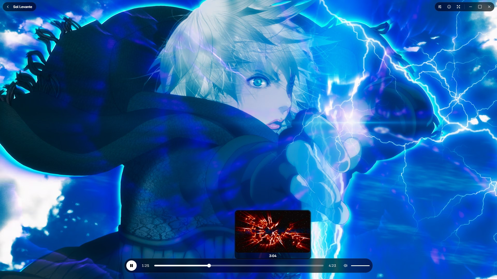
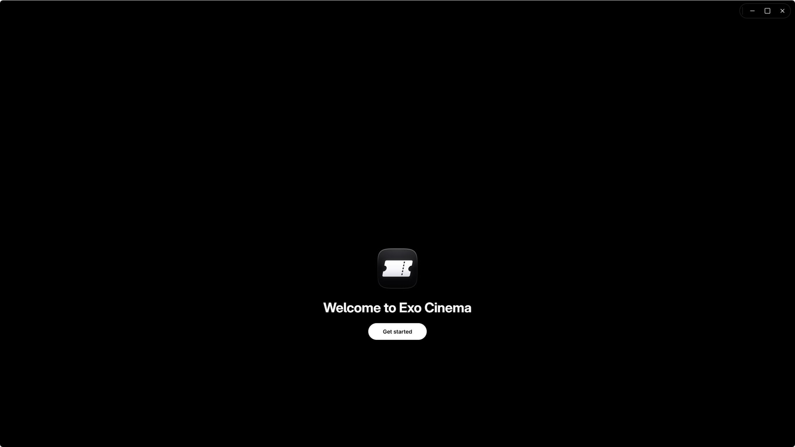
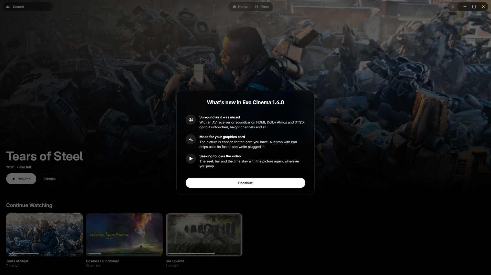

<p align="center"></p>
<h1 align="center">Exo Cinema</h1>
<p align="center"><strong>Films and shows from your add-ons in Exo's look for Windows 11, with a native player that keeps up with anything.</strong></p>

<p align="center">
  <a href="https://github.com/UhhErix/ExoCinema/releases/latest/download/ExoCinema-Setup.exe"><strong>Download for Windows 11</strong></a>
  · <a href="https://github.com/UhhErix/ExoCinema/releases/tag/v1.4.6">What's new in 1.4.6</a>
  · <a href="CHANGELOG.md">Changelog</a>
  · <a href="PRIVACY.md">Privacy</a>
  · <a href="SECURITY.md">Security</a>
  · <a href="LICENSE">License</a>
</p>



## Download

| File | Version | SHA-256 |
| --- | --- | --- |
| [ExoCinema-Setup.exe](https://github.com/UhhErix/ExoCinema/releases/download/v1.4.6/ExoCinema-Setup.exe) | 1.4.6 | `58f7c8029715e2e2f8d42d81900b770a143623808300d46938685d0ba05f2515` |

**Requirements:** Windows 11 x64 with WebView2 (built into Windows 11; Setup installs it if it's missing). Installs for your Windows user only, in `%LOCALAPPDATA%\ExoCinema\app`, with no administrator rights.

**Check your download.** The installer isn't code-signed yet, so Windows SmartScreen may warn the first time (choose **More info**, then **Run anyway**). Before you run it, check that its hash matches the one above and on the [release page](https://github.com/UhhErix/ExoCinema/releases/tag/v1.4.5):

```powershell
Get-FileHash .\ExoCinema-Setup.exe -Algorithm SHA256
```

## Install

1. Download **ExoCinema-Setup.exe** (above) and check its hash.
2. Run it, choose **Install**, then **Open Exo Cinema**. The first run lets you sign in to your Exo account, add your add-ons and set how you like to watch; none of it is needed to start. Every choice can be changed later in Settings.
3. When a new version is out, Exo Cinema offers it as it opens: **Update now** downloads it, checks it and installs it over the one you have, and your add-ons, history and settings stay. It never interrupts while it's open.



## What's built in


- **Your Jellyfin server, in one sign-in:** connect with its address, username and password and it's your library: Home, Movies, Shows, search and every title. Where you left off, what's played and your favorites live on the server, so other Jellyfin apps that report to it stay in step. It plays the original file, never a conversion.
- **Films and shows from add-ons:** without a server, Stremio-protocol add-ons give Exo Cinema its rows, titles and streams. Cinemeta, Stremio's public catalog, is built in; add yours in Settings › Add-ons and their rows come first. Movies and Shows browse every list by genre, every show by season, and Ctrl+K searches them all.
- **Exo Watch, built in:** Continue Watching (with each show's next episode), the Watchlist and History are Exo Cinema's own, kept as you watch: where you stop every 30 seconds, and watched once you're past nine tenths.
- **Your Exo account carries it:** sign in and your add-ons, Exo Watch and your choices come with you to your other PCs, end-to-end encrypted.
- **A native player:** mpv draws the picture with hardware decoding, HDR and Dolby Vision tone mapping and high-quality scaling, at the video's own frame rate.
- **HDR for films, automatic:** a film or show with an HDR picture switches its screen to HDR while it plays and back after, with no setting, and stays on through a change to the next HDR episode that starts within ten seconds. _Checked in code only._
- **Liquid Glass over the picture:** the controls blur the video under them as it plays, drawn by the player on the graphics card at no cost to playback.
- **Pictures on the seek bar:** hover it to see the moment you'd jump to, drawn on the spot, and drag it as fast as you like.
- **The best stream and tracks for you:** every add-on's streams ranked by their details for your PC and connection, and the best recording in the language you'd expect, with full subtitles in yours when you need them.
- **The things you reach for:** audio and subtitle tracks remembered for each show, playback speed, Skip intro and Skip credits, and Up Next that plays the next episode on its own.
- **Steady over a slow link:** the player reads far ahead, waits for a few seconds of picture rather than stuttering, and reconnects when a host drops the stream.
- **Media keys and Windows' media controls:** play, pause and next from the keyboard with another window in front, and what's playing, with its poster, in Windows' media controls and Exo Launcher's Now Playing.
- **Light on your PC:** close to no CPU while idle or behind a game, and the picture's quality picked for your PC as it plays.
- **Exo Launcher's look:** Void black, Liquid Glass or solid, Geist and Exo's icons, and an opening that has Home ready when it lifts.

## The player

- **Built on mpv.** libmpv decodes and draws into the window itself, under the interface, so the picture never passes through a web page: hardware decoding through Direct3D 11, mpv's high-quality scalers picked for your PC as it plays (lighter on integrated graphics, on battery, or when frames drop), and HDR and Dolby Vision tone mapped for your screen.
- **Anime redrawn by ArtCNN.** A neural network trained on drawn art redraws anime at up to 4K and shrinks it back to your screen: crisp lines, backgrounds with their texture. It was chosen on a picture bench against Anime4K and NVIDIA's upscaler, and it is built for your graphics card once, in the background.
- **AI upscaling on RTX cards.** A film or show smaller than your screen is enlarged by NVIDIA's RTX Video Super Resolution when it's switched on (Exo Launcher's PC > Display). Both upscalers step aside while a game runs. On a laptop with two graphics chips, the player draws on the faster one while it's plugged in.
- **Surround as it was mixed.** With an AV receiver or soundbar on HDMI, Dolby Atmos, DTS:X and the rest go to it untouched, so it plays their height channels, and its own volume sets the level. It steps aside while another app plays through it, a game runs or an Exo voice call is on.
- **Pictures on the seek bar.** Hover it for the moment you'd jump to, drawn on the spot by a second player kept out of sight.
- **Glass that moves with the picture.** The glass under the controls is drawn by the player as part of each frame, so it never lags the video and never copies frames off the graphics card. With the controls up over 4K60 Dolby Vision, the test PC dropped no frames.
- **Audio, subtitles and speed** live in one menu under the sliders button at the top right. A video starts on its best recording in the language you'd expect (Japanese for anime) with full subtitles in yours when the audio isn't; pick a language once and the show's next episodes start with it. Plain subtitles are drawn in Inter and rise above the controls while they show.
- **Skip intro and Up Next.** Openings and credits named in the file's chapters get a Skip button; near the end of an episode the next one counts down, and **Not now** stops it.
- **Keys you know:** Space or K to pause, arrows to seek and set the volume, J and L for ten seconds, F for full screen, M to mute, I for what's playing and how.

## Settings

- **Look:** Liquid Glass or solid, and Reduce motion.
- **Playback:** Source (play the best stream of a title for this PC and connection, or ask which, with every stream your add-ons offer) and whether the next episode plays by itself. The picture's quality and hardware decoding need no setting: Exo Cinema picks them for your PC.
- **Jellyfin:** your server's address, username and password, and **Connect**, which says whether it really worked; then who's connected, and **Sign out**.
- **Add-ons:** yours, in order: add one by its link, move it up or down, or remove it. Each shows its name and host, never the rest of its link.
- **Exo account:** who's signed in, Profile and Sign out.
- **About:** your version, what's new, and Check for updates.



## How it works

Exo Cinema is a native Windows app built like Exo Launcher: WinUI 3 on .NET, with its interface in one Microsoft Edge WebView2 page that floats over the video. The picture comes from libmpv, which draws straight into the window.

- **Its own interface:** Exo Cinema's page, served from the app folder, not the web. Everything it shows, pictures included, comes through the app.
- **Your add-ons, directly:** Exo Cinema asks Cinemeta and your add-ons itself and plays from the address they answer with. There is no Exo server in between.

## Privacy and safety

- **Optional Exo account, no ads, no analytics, no telemetry.** Watching needs no account. If you sign in, your add-ons, Exo Watch and choices sync end-to-end encrypted. The update check sends no viewing history. Without sync, your add-ons, Exo Watch and settings stay on your PC.
- **What leaves your PC** is what watching needs: requests to Cinemeta and its picture hosts, to your add-ons and your Jellyfin server if you connect one (for what you open and play), and the update check as Exo Cinema opens (Exo's update address, `updates.getexo.app`, or GitHub when it doesn't answer). The [privacy policy](PRIVACY.md) lists every destination and what is sent.
- **Your Jellyfin sign-in stays on this PC.** The password is never kept; the server's token is sealed with Windows' data protection, doesn't sync through your Exo account and, like the server's address, is never written to the log.
- **Your add-ons' links stay yours.** They often carry their owner's keys, so Exo Cinema shows only their host, never writes them to its log, and keeps them sealed with Windows' data protection for your Windows user.
- **Found a security problem?** [Report it privately](https://github.com/UhhErix/ExoCinema/security/advisories/new), not in a public issue. See [SECURITY.md](SECURITY.md).

Film images in these pictures: Sol Levante © Akira Saitoh, Production I.G, Netflix (CC BY 4.0); Tears of Steel, Sintel, Big Buck Bunny, Cosmos Laundromat (CC BY 3.0), Spring, Elephants Dream (CC BY 4.0) © Blender Foundation. They come from a test server, not anyone's library.

## Contributing

Bug reports, ideas and clearer wording are welcome. Read [CONTRIBUTING.md](CONTRIBUTING.md) first: it explains what you agree to when you send a change, since Exo Cinema isn't open source.

## License

Exo Cinema is **free for personal use**. It is not open source, and from 1.4.0 on its source isn't published. The full terms are in [LICENSE](LICENSE); this is a plain summary, and LICENSE wins if they differ.

| You can | You need written permission to |
| --- | --- |
| Download, install and run the official app on your devices | Copy, mirror or redistribute the app or its source |
| Replace its libmpv with your own build, as libmpv's license allows | Publish, sell or rebrand a changed version |
| Suggest changes to these pages as pull requests ([CONTRIBUTING.md](CONTRIBUTING.md)) | |

To ask for permission, [open an issue](https://github.com/UhhErix/ExoCinema/issues). The app is provided as is, without warranty.

**Open-source parts that ship with Exo Cinema** keep their own licenses, and their source is public:

- [libmpv](https://github.com/mpv-player/mpv) (LGPL), the player, with [FFmpeg](https://github.com/FFmpeg/FFmpeg) (LGPL) inside it. It ships as its own file you may replace with your own build.
- [ArtCNN](https://github.com/Artoriuz/ArtCNN) (MIT), the anime upscaler's network, as mpv shaders.

Every bundled library, font and tool is listed in [Third-party notices](THIRD_PARTY_NOTICES.md).

**Not affiliated.** Exo Cinema is independent and not affiliated with or endorsed by Stremio, the Jellyfin project, the mpv or FFmpeg projects, Microsoft, or any service it works with. Their names and logos belong to their owners. The video in the pictures above is Jellyfin's test footage ([CC BY-SA 4.0](https://creativecommons.org/licenses/by-sa/4.0/)), and the server and user in them are made up.

## Also from Exo

- **[Exo Launcher](https://github.com/UhhErix/ExoLauncher)** — every game store, Discord, music, captures and mouse in one app
- **[Exo Browser](https://github.com/UhhErix/ExoBrowser)** — private browser with Exo Shield and Exo Vault built in

---

[Help](docs/HELP.md) · [Report an issue](https://github.com/UhhErix/ExoCinema/issues) · [Support development](https://www.buymeacoffee.com/UhhErix)

© 2026 Erix ([UhhErix](https://github.com/UhhErix)).
